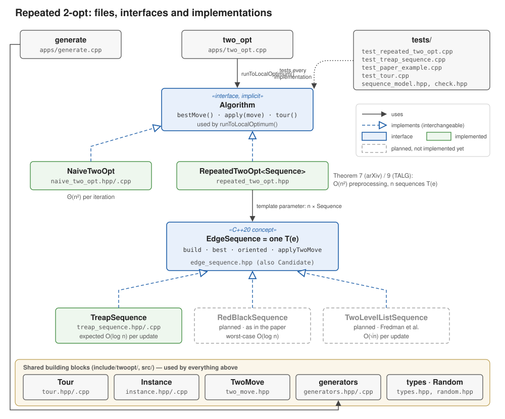

# Repeated 2-opt in O(n log n) per iteration

C++20 implementation of repeated **2-opt Optimization** from

> M. de Berg, K. Buchin, B. M. P. Jansen, G. Woeginger.
> *Fine-Grained Complexity Analysis of Two Classic TSP Variants.*
> ACM Transactions on Algorithms 17(1), 2021 (Theorem 9); arXiv:1607.02725 (Theorem 7).

After O(n²) preprocessing and with O(n²) storage, every iteration finds the best
2-move on a complete graph and applies it in O(n log n) time.
A naive Θ(n²)-per-iteration search is included as a reference.

## Build and test

```bash
cmake -S . -B build
cmake --build build -j
ctest --test-dir build --output-on-failure
```

## Usage

```bash
build/generate instance euclidean 1000 42 > instance.txt   # uniform|metric|euclidean|clustered|circle|grid
build/generate tour random 1000 42 > tour.txt               # identity|random
build/two_opt instance.txt --tour tour.txt --algorithm treap   # or naive; --print-tour
```

Instance file: `n`, then the symmetric n×n weight matrix. Tour file: `n`, then the vertices
in tour order. `#` starts a comment. Weights are integers, so all comparisons are exact.

## How it works

For every tour edge e = a→b there is one sequence T(e) over the path P(e) from b to a.
For an edge c→d on that path, the 2-move replacing a→b, c→d by a→c, b→d changes the
tour length by w(a,c) + w(b,d) − w(a,b) − w(c,d). T(e) keeps the minimum of this value,
so the best move overall is the minimum over the n sequences.

After a move, the two sequences of the removed edges are rebuilt in O(n). Every other
sequence is updated in O(log n): split off the part between the two removed edges,
reverse it lazily, insert the two new edges, and join.

## Code layout



`include/` holds only interfaces; every implementation lives in `src/`.

```
include/twoopt/                   src/
  data_structure/                   data_structure/
    edge_sequence.hpp                 treap_sequence.hpp/.cpp      T(e) as a treap with lazy reversal
  algorithm/                        algorithm/
    two_opt_algorithm.hpp             repeated_two_opt.hpp/.cpp    Theorem 7/9, templated on T(e)
                                      naive_two_opt.hpp/.cpp       Θ(n²) reference search
  util/                             util/
    tour.hpp                          tour.cpp                     tour array with stable edge ids
    instance.hpp                      instance.cpp                 weight matrix
    two_move.hpp                                                   TwoMove, its order, delta formula
    generators.hpp                    generators.cpp               instances and start tours
    types.hpp                         random.hpp, io.hpp           RNG, file parsing
apps/                                                              command-line programs
tests/                                                             checks against the naive search and rebuilt T(e)
```

### Adding another sequence implementation

Implement the four operations of `EdgeSequence` (`build`, `best`, `oriented`,
`applyTwoMove`; see `include/twoopt/data_structure/edge_sequence.hpp`). Then add one line
`template class RepeatedTwoOpt<YourSequence>;` at the end of
`src/algorithm/repeated_two_opt.cpp`, and one test call each in
`tests/test_treap_sequence.cpp` and `tests/test_repeated_two_opt.cpp`. The algorithm
itself does not change: `RepeatedTwoOpt<YourSequence>`.
A new algorithm implements `TwoOptAlgorithm` (`include/twoopt/algorithm/two_opt_algorithm.hpp`) and is
compared with `NaiveTwoOpt` in `tests/test_repeated_two_opt.cpp`.

## Differences from the paper

- The paper uses red-black trees (worst-case O(log n)). The treap gives expected
  O(log n) per operation.
- Each of the n² tree nodes takes about 80 bytes; n = 1500 needs about 200 MB.
